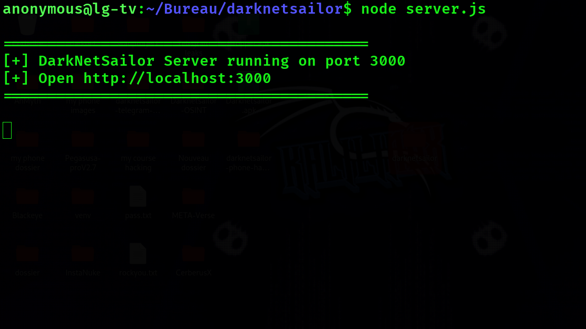
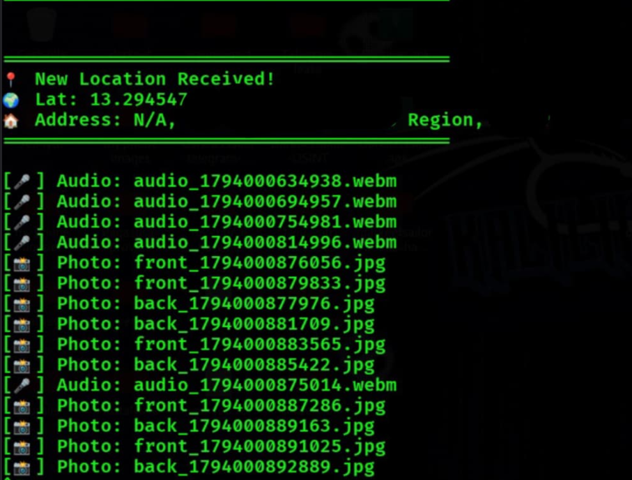
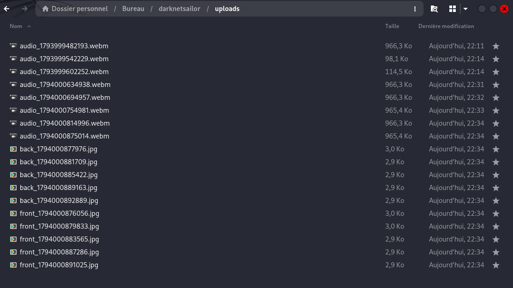

<div align="center">

# 🛡️ DarkNetSailor - Advanced Device Recon Tool

**`darknetsailor-device-hacking`**

[](#)
[](#)
[](#)
[](#)

أداة احترافية تستهدف الهواتف والكمبيوتر عبر المتصفح (Browser-based Exploitation) لاكتشاف الثغرات والتقاط البيانات. تعمل الأداة كمنصة استطلاع متقدمة (Advanced Reconnaissance) دون الحاجة لتثبيت أي تطبيق على جهاز الهدف.

</div>

---

> ⚠️ **إخلاء المسؤولية (Disclaimer):** 
> هذه الأداة تم تطويرها **لغرض التعليم واختبار الاختراق الأخلاقي (Ethical Hacking) فقط**. لا يُسمح باستخدامها على أجهزة أو شبكات لا تملك إذناً صريحاً ومكتوباً باختبارها. المطورون يخليون مسؤوليتهم التامة عن أي سوء استخدام أو أضرار ناتجة عن هذه الأداة.

---

## 📸 صور توضيحية (Screenshots)

<div align="center">

**1. جلسة استماع واستقبال البيانات في التيرمينال (Listening Session)**


**2. عرض النتائج (الموقع الجغرافي، الصوتيات، والصور)**


**3. المجلد الذي يتم حفظ البيانات فيه (Uploads Folder)**


</div>

---

## 🚀 المميزات (Features)

توفر الأداة واجهة خفية وسريعة تعمل مباشرة من المتصفح (بدون تنزيل تطبيقات)، وتقوم بالآتي:

*   🎤 **التقاط الصوت (Audio Capture):** تسجيل مستمر للمحيط في الخلفية وإرسال مقاطع صوتية للخادم تلقائياً.
*   📸 **التقاط الكاميرا (Camera Snapshots):** التقاط صور دورية من الكاميرا الأمامية (Front Camera) والخلفية (Back Camera).
*   📍 **الموقع الجغرافي (Geolocation):** سحب إحداثيات دقيقة (Latitude & Longitude) وعرض اسم الدولة، المنطقة، والشارع تلقائياً.
*   📱 **يعمل عبر المتصفح (Browser-based):** لا يحتاج لتثبيت تطبيق (APK)؛ يعمل على الهواتف والكمبيوتر بمجرد فتح الرابط.
*   🛡️ **واجهة خادعة (Social Engineering):** تصميم واجهة مستخدم أنيقة ومقنعة تجعل الضحية يمنح الصلاحيات بسهولة.

---

## 🧠 كيف تعمل الأداة؟ (How it Works)

تعتمد الأداة على تقنيات الويب الحديثة (Web APIs) لطلب صلاحيات المتصفح (Browser Permissions):
1.  يقوم المهاجم بتشغيل الخادم (C2 Server) وإنشاء رابط (Link).
2.  عندما يفتح الهدف الرابط، تظهر له واجهة تطلب الإذن بالوصول إلى (الكاميرا، الميكروفون، والموقع).
3.  بمجرد موافقة الهدف (Permissions Granted)، يبدأ المتصفح في تشغيل السكريبتات الخلفية وإرسال البيانات (Data Exfiltration) إلى الخادم بشكل متتالي.

---

## ⚙️ التثبيت والتشغيل (Installation & Usage)

### 1️⃣ المتطلبات الأساسية
تأكد من تثبيت **Node.js** على نظامك (Kali Linux / Ubuntu / Windows / Mac).

### 2️⃣ تحميل وتثبيت الأداة
```bash
# استنساخ المستودع
git clone https://github.com/darknetsailorpro-droid/darknetsailor-device-hacking.git

# الدخول لمجلد المشروع
cd darknetsailor-device-hacking

# تثبيت المكتبات والتبعيات
npm install


3️⃣ تشغيل الخادم


node server.js


سيعمل الخادم على المنفذ 3000، وستظهر لك رسالة تؤكد ذلك.

4️⃣ الاستهداف
 
⚠️ تنبيه: المتصفحات الحديثة تمنع طلب صلاحيات الكاميرا والميكروفون عبر بروتوكول HTTP العادي. يجب استخدام HTTPS.

استخدم أداة مثل Ngrok لإنشاء نفق آمن:


ngrok http 3000

سيظهر لك رابط https://...، أرسله للهدف (في بيئة معزولة)، وستبدأ البيانات بالوصول مباشرة إلى مجلد uploads الخاص بك.

☕ دعم القناة
إذا أعجبك هذا المشروع التعليمي، ولاستمرار تقديم المزيد من الأدوات والدروس في مجال الأمن السيبراني:


https://youtube.com/@darknetsailorpro-o1l?si=8l6ppozwqhmTyKlm

🔔 اشترك في القناة الآن
👍 لا تنسَ الإعجاب  لدعمنا
</div>
تم التطوير بكل حب 🖤 بواسطة Darknetsailor.


